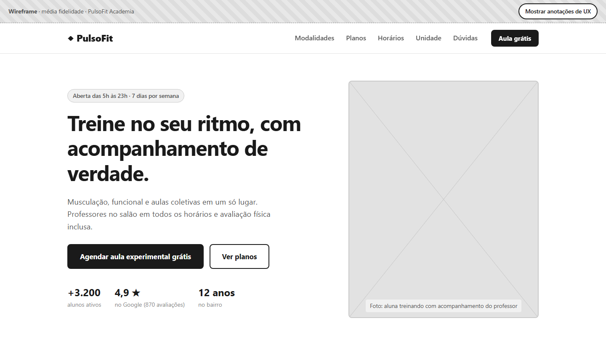
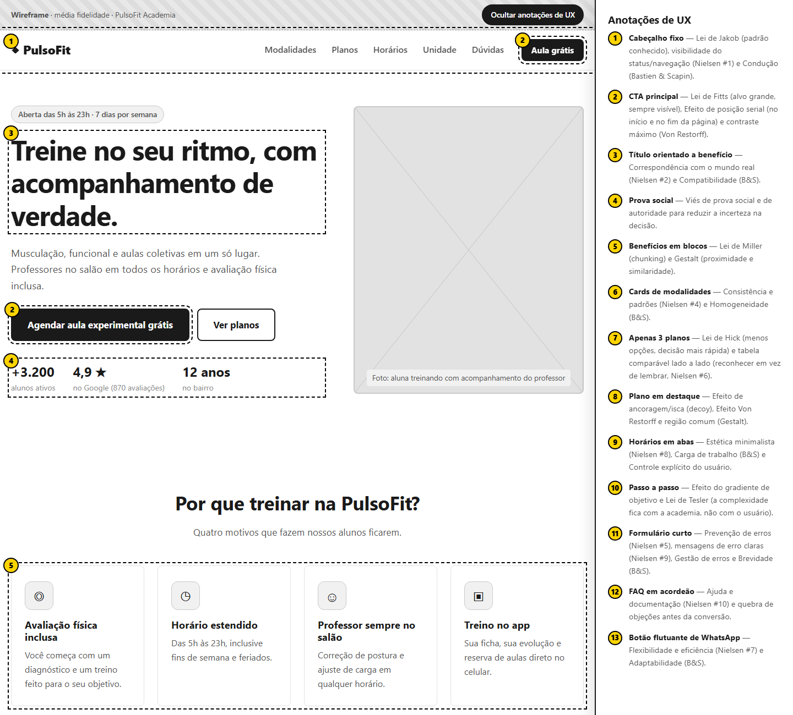
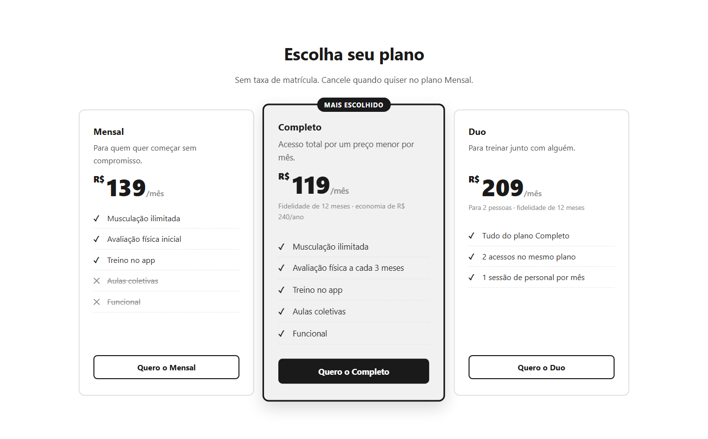
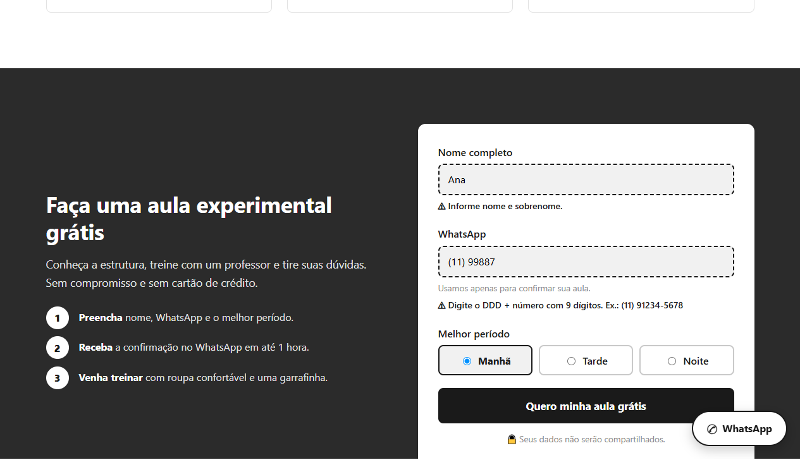
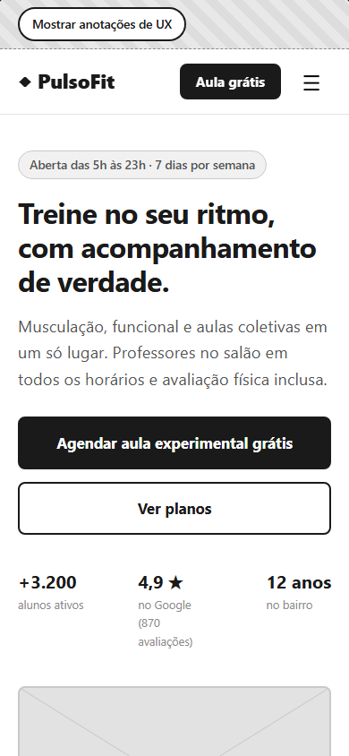
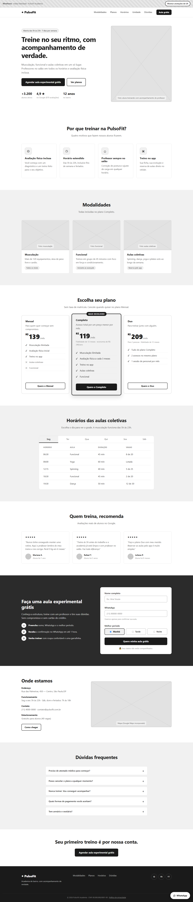
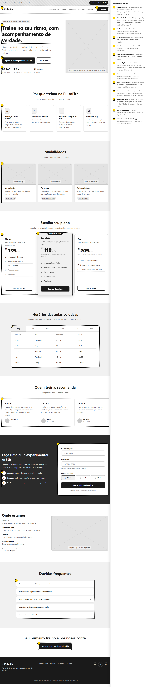

# PulsoFit Academia — Wireframe de média fidelidade (One Page)

Wireframe de média fidelidade de uma landing page (One Page) para a **PulsoFit**, uma academia de bairro fictícia. Projeto desenvolvido para o desafio de UX/UI da [DIO](https://www.dio.me/), aplicando conceitos de **psicologia do design**, **Leis de UX**, as **10 heurísticas de Nielsen** e os **critérios ergonômicos de Bastien & Scapin**.



---

## Sumário

- [Sobre o produto](#sobre-o-produto)
- [Objetivos](#objetivos)
- [Público e persona](#público-e-persona)
- [Por que média fidelidade?](#por-que-média-fidelidade)
- [Arquitetura da página](#arquitetura-da-página)
- [Decisões de design](#decisões-de-design)
  - [Psicologia e Leis de UX](#psicologia-e-leis-de-ux)
  - [Heurísticas de Nielsen](#heurísticas-de-nielsen)
  - [Critérios ergonômicos de Bastien & Scapin](#critérios-ergonômicos-de-bastien--scapin)
  - [Acessibilidade](#acessibilidade)
- [Modo anotações](#modo-anotações)
- [Capturas de tela](#capturas-de-tela)
- [Como visualizar](#como-visualizar)
- [Estrutura do projeto](#estrutura-do-projeto)
- [Próximos passos](#próximos-passos)

---

## Sobre o produto

A **PulsoFit** é uma academia com musculação, funcional e aulas coletivas, aberta das 5h às 23h. O diferencial que a página precisa comunicar é o **acompanhamento de verdade**: professor no salão em todos os horários e avaliação física inclusa.

A página tem uma única ação principal: **agendar uma aula experimental grátis**. Todo o resto do conteúdo existe para levar o visitante até essa ação ou tirar as dúvidas que o impedem de chegar lá.

## Objetivos

**Do negócio**

- Converter visitantes em leads qualificados (aula experimental agendada).
- Direcionar a escolha para o plano Completo (fidelidade de 12 meses).
- Reduzir o volume de perguntas repetidas no WhatsApp e na recepção.

**Do usuário**

- Entender rapidamente o que a academia oferece e quanto custa.
- Ver se os horários das aulas combinam com a rotina.
- Ter segurança de que vai ser bem acompanhado, mesmo sendo iniciante.
- Experimentar antes de assinar, sem burocracia.

## Público e persona

> **Camila, 29 anos, analista administrativa.**
> Já se matriculou em academias duas vezes e desistiu nas primeiras semanas porque se sentia perdida no salão e ninguém a orientava. Trabalha das 9h às 18h e só consegue treinar cedo ou à noite. Pesquisa pelo celular, compara preços e lê avaliações no Google antes de decidir.

**Dores:** medo de se sentir deslocada, falta de orientação, horários incompatíveis, contratos com multa.
**O que ela procura na página:** preço claro, horários, prova de que há acompanhamento e uma forma de testar sem compromisso.

Cada seção da página responde a uma dessas dores (veja a [arquitetura](#arquitetura-da-página)).

## Por que média fidelidade?

Um wireframe de média fidelidade fica entre o rascunho (baixa) e o protótipo visual final (alta):

| Característica | Como aparece neste wireframe |
| --- | --- |
| Cores | Somente escala de cinza, para avaliar hierarquia sem a influência da identidade visual |
| Imagens | Placeholders com "X" e legenda descrevendo a foto prevista |
| Textos | Conteúdo real (títulos, preços, FAQ), não *lorem ipsum*, para testar a clareza da mensagem |
| Tipografia e espaçamento | Hierarquia definida (H1, H2, H3, corpo) e grid consistente |
| Interações | Básicas e funcionais: menu, abas, acordeão, validação do formulário |

O wireframe foi construído em **HTML, CSS e JavaScript** puro, o que permite navegar e testar as interações no navegador e no celular, como um protótipo navegável. Se preferir trabalhar no Figma, a página pode ser importada com o plugin *html.to.design*.

## Arquitetura da página

A ordem das seções segue o modelo **AIDA** (Atenção, Interesse, Desejo, Ação), respondendo às perguntas do visitante na ordem em que elas surgem:

| # | Seção | Pergunta do visitante que ela responde |
| --- | --- | --- |
| 1 | Cabeçalho fixo | "Onde encontro o que procuro?" |
| 2 | Hero com CTA e prova social | "O que é isso e por que devo me importar?" |
| 3 | Benefícios (4 cards) | "Por que esta academia e não outra?" |
| 4 | Modalidades | "O que eu posso fazer lá?" |
| 5 | Planos | "Quanto custa?" |
| 6 | Horários das aulas | "Encaixa na minha rotina?" |
| 7 | Depoimentos | "Outras pessoas como eu gostaram?" |
| 8 | Aula experimental (formulário) | "Como eu começo?" |
| 9 | Unidade e mapa | "Onde fica? Tem estacionamento?" |
| 10 | Dúvidas frequentes | "E se eu tiver uma objeção?" |
| 11 | CTA final | Última chamada para a ação |
| 12 | Rodapé | Links, redes sociais e dados legais |

## Decisões de design

### Psicologia e Leis de UX

| Princípio | Onde foi aplicado | Por quê |
| --- | --- | --- |
| **Lei de Jakob** | Logo à esquerda, menu à direita, CTA no canto superior direito, FAQ em acordeão | O usuário passa a maior parte do tempo em outros sites; seguir padrões conhecidos elimina a curva de aprendizado |
| **Lei de Fitts** | Botões principais com 56 px de altura, CTA "Aula grátis" sempre visível no cabeçalho fixo, botão flutuante de WhatsApp | Alvos grandes e próximos são mais rápidos de acertar, principalmente no toque |
| **Lei de Hick** | Apenas 5 itens no menu, 3 planos e 3 opções de período no formulário | Menos opções reduzem o tempo de decisão e a paralisia de escolha |
| **Lei de Miller (chunking)** | Benefícios em 4 blocos, horários divididos por dia, FAQ em itens recolhidos | A informação é dividida em pedaços pequenos que cabem na memória de trabalho |
| **Efeito Von Restorff (isolamento)** | Plano Completo com borda grossa, fundo diferente, sombra, escala maior e selo "Mais escolhido" | O item diferente dos demais é o mais lembrado e o mais escolhido |
| **Efeito de ancoragem e isca (*decoy*)** | Plano Mensal (R$ 139) ao lado do Completo (R$ 119) com mais benefícios | O preço maior serve de âncora e faz o Completo parecer a escolha óbvia |
| **Efeito de posição serial** | CTA "Agendar aula experimental grátis" no início (hero) e no fim (CTA final) da página | Lembramos melhor do primeiro e do último item de uma sequência |
| **Prova social** | Números no hero (+3.200 alunos, nota 4,9 no Google) e depoimentos com tempo de casa | Reduz a incerteza: "se tanta gente aprova, deve ser bom" |
| **Lei de Tesler (conservação da complexidade)** | Formulário com só 3 campos; a academia é quem entra em contato para confirmar | A complexidade de agendar fica do lado do sistema, não do usuário |
| **Efeito do gradiente de objetivo** | Passo a passo numerado (1, 2, 3) ao lado do formulário | Ver que faltam poucos passos aumenta a motivação para concluir |
| **Gestalt: proximidade, similaridade e região comum** | Cards com mesmo formato e espaçamento; rótulo, campo, ajuda e erro agrupados; plano em destaque dentro de uma região própria | O cérebro agrupa elementos próximos e parecidos, o que facilita a leitura |
| **Efeito estético-usabilidade** | Grid consistente, bastante espaço em branco e hierarquia tipográfica clara | Interfaces organizadas são percebidas como mais fáceis de usar |

### Heurísticas de Nielsen

| # | Heurística | Aplicação no wireframe |
| --- | --- | --- |
| 1 | Visibilidade do status do sistema | Item do menu destacado conforme a seção visível; vagas por aula na grade ("2 de 20", "Lotada"); confirmação "Pronto! Pedido recebido" após o envio |
| 2 | Correspondência entre o sistema e o mundo real | Linguagem do aluno ("Aula grátis", "Treino no app", "Melhor período"), sem jargão; preços em R$/mês |
| 3 | Controle e liberdade do usuário | Plano Mensal sem fidelidade; FAQ que abre e fecha; abas de dias que o usuário escolhe; link "Pular para o conteúdo" |
| 4 | Consistência e padrões | Mesmo estilo para todos os botões primários e secundários, cards com estrutura idêntica, mesmo CTA com o mesmo texto em toda a página |
| 5 | Prevenção de erros | Máscara automática no WhatsApp, exemplo de preenchimento no *placeholder*, período pré-selecionado e opções em botões grandes em vez de campo livre |
| 6 | Reconhecimento em vez de memorização | Planos lado a lado com lista de benefícios comparável (✓ e ✕), sem precisar lembrar o que cada um inclui |
| 7 | Flexibilidade e eficiência de uso | Atalhos no menu fixo, CTA no cabeçalho e WhatsApp flutuante para quem já está decidido; navegação por teclado nas abas (setas, Home, End) |
| 8 | Estética e design minimalista | Somente o conteúdo necessário em cada seção; horários escondidos em abas; FAQ recolhido |
| 9 | Ajudar a reconhecer, diagnosticar e recuperar erros | Mensagens de erro específicas e com solução ("Digite o DDD + número com 9 dígitos. Ex.: (11) 91234-5678"), exibidas junto ao campo, e foco levado ao primeiro campo com problema |
| 10 | Ajuda e documentação | Seção de Dúvidas frequentes, texto de ajuda no campo de WhatsApp e passo a passo do que acontece após o envio |

### Critérios ergonômicos de Bastien & Scapin

| Critério | Aplicação no wireframe |
| --- | --- |
| **Condução** (presteza, agrupamento, *feedback* imediato, legibilidade) | Cabeçalho fixo com âncoras, seções com título e subtítulo, *feedback* do formulário em tempo real, alto contraste e corpo de texto de 16 px |
| **Carga de trabalho** (brevidade, densidade informacional) | Formulário com 3 campos, textos curtos, informações densas (horários) divididas em abas |
| **Controle explícito** (ações explícitas, controle do usuário) | Nada acontece sem clique: o envio só ocorre ao apertar o botão, as abas e o FAQ só abrem quando o usuário escolhe |
| **Adaptabilidade** (flexibilidade, experiência do usuário) | Layout responsivo (desktop, tablet e celular); vários caminhos para converter (CTA, formulário, WhatsApp) |
| **Gestão de erros** (proteção, qualidade das mensagens, correção) | Validação ao sair do campo, mensagem que explica como corrigir, erro que some assim que o valor fica válido |
| **Homogeneidade / Consistência** | Mesmos componentes, cores, espaçamentos e posições ao longo da página |
| **Significado dos códigos e denominações** | Ícones sempre acompanhados de texto, ✓ para incluso e ✕ riscado para não incluso, "Lotada" escrito por extenso |
| **Compatibilidade** | Ordem das seções segue o raciocínio de compra do usuário; vocabulário e formatos brasileiros (R$, telefone com DDD, endereço) |

### Acessibilidade

- HTML semântico (`header`, `nav`, `main`, `section`, `footer`, `address`, `figure`) e hierarquia correta de títulos.
- Link "Pular para o conteúdo" para quem navega por teclado.
- Abas no padrão WAI-ARIA (`role="tablist"`, `aria-selected`, navegação por setas).
- Campos com `label`, `aria-describedby` para ajuda e erro, `aria-invalid` e mensagens em região `aria-live`.
- Foco visível em todos os elementos interativos.
- Alvos de toque com no mínimo 44 × 44 px.
- Respeito a `prefers-reduced-motion`.

## Modo anotações

No topo da página há o botão **"Mostrar anotações de UX"**. Ele numera na própria interface cada ponto onde um princípio foi aplicado e abre uma legenda lateral explicando a decisão. Também é possível abrir direto com o endereço `index.html?anotacoes`.



## Capturas de tela

**Seção de planos:** destaque do plano Completo (Von Restorff, ancoragem e Lei de Hick).



**Formulário com validação:** mensagens de erro claras e próximas ao campo (heurísticas 5 e 9, gestão de erros).



**Versão mobile:** CTA em largura total, menu hambúrguer e WhatsApp flutuante.



**Página completa:**

| Desktop | Desktop com anotações | Mobile |
| --- | --- | --- |
| [](images/desktop-completo.png) | [](images/desktop-anotado.png) | [](images/mobile-completo.png) |

## Como visualizar

**Opção 1:** abra o arquivo `index.html` direto no navegador.

**Opção 2:** rode um servidor local na pasta do projeto:

```bash
python -m http.server 5500
# acesse http://localhost:5500
```

**Opção 3 (GitHub Pages):** no repositório, vá em *Settings → Pages*, selecione a branch `main` e a pasta `/ (root)`. A página ficará disponível em `https://SEU-USUARIO.github.io/NOME-DO-REPOSITORIO/`.

## Estrutura do projeto

```
.
├── index.html          # Wireframe (estrutura e conteúdo)
├── css/
│   └── style.css       # Estilos em escala de cinza + modo anotações + responsivo
├── js/
│   └── main.js         # Menu, abas, validação do formulário e modo anotações
├── images/             # Capturas de tela usadas neste README
└── README.md
```

**Tecnologias:** HTML5, CSS3 (Grid, Flexbox, custom properties, `:has()`) e JavaScript puro, sem dependências.

## Próximos passos

- Fazer **teste de usabilidade** com 5 usuários no perfil da persona, com a tarefa "agende uma aula experimental no horário da noite".
- Evoluir para **alta fidelidade** no Figma: identidade visual, paleta de cores, fotos reais e ícones.
- Medir a conversão com **teste A/B** do texto do CTA e da ordem entre Planos e Horários.
- Integrar o formulário ao WhatsApp/CRM da academia e o mapa ao Google Maps.

---

Projeto desenvolvido para o desafio **"Criando um wireframe de média fidelidade"** da DIO.
